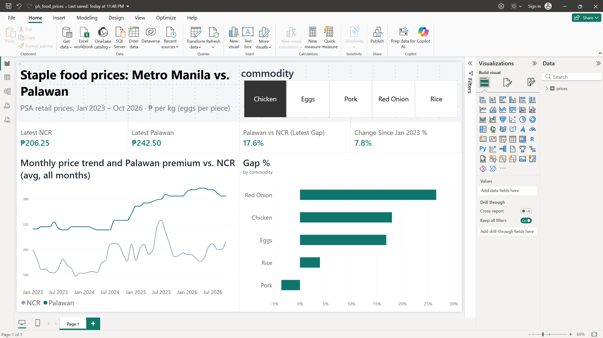

# Staple Food Prices: Metro Manila vs. Palawan (2023–2026)

How much more do Palawan households pay for basic food than Metro Manila, and which staples rose fastest?

## Key findings

- **Palawan paid more for chicken and eggs in all 46 months** (Jan 2023 – Oct 2026), about 18% more for chicken and 17% more for eggs on average.
- **Rice was the fastest-rising staple:** +19.9% in Palawan (₱40.33 → ₱48.37/kg) and +18.9% in NCR, peaking at ₱50.87/kg in Palawan in May 2026.
- **Red onion fell 71% (NCR) and 55% (Palawan)** from its January 2023 crisis peak, but Palawan still paid 38.5% more than NCR as of October 2026, the widest gap of any item.
- **Pork is the exception:** it was cheaper in Palawan in 39 of 46 months.

## Data

- Source: Philippine Statistics Authority (PSA) OpenSTAT, Retail Prices of Agricultural Commodities (2018-based series)
- 5 commodities × 2 locations (NCR, Palawan province) × 46 months = 460 records
- November–December 2026 were not yet released at the time of analysis.

## Tools and process

1. **Python (pandas):** combined 5 raw PSA files, detected mixed delimiters, reshaped wide to long, and cleaned location and commodity names (`clean_data.py`)
2. **MySQL:** loaded the clean data and wrote analysis queries using CTEs, CASE pivots and window functions (LAG, ROW_NUMBER) (`sql/`)
3. **Power BI:** built an interactive dashboard with DAX measures for latest prices, regional gap % and change since January 2023 (`ph_food_prices.pbix`)

## Project structure

| Path                     | Contents                         |
| ------------------------ | -------------------------------- |
| `raw/`                   | Original PSA CSV downloads       |
| `clean/prices_clean.csv` | Cleaned, long-format dataset     |
| `clean_data.py`          | Cleaning script                  |
| `sql/`                   | Table setup and analysis queries |
| `ph_food_prices.pbix`    | Power BI dashboard               |
| `theme.json`             | Custom Power BI theme            |

## Author

Elidan Fuertes · BSIT, Holy Trinity University
[LinkedIn](https://linkedin.com/in/elidanfuertes) · [Portfolio](https://elidigital.netlify.app)
